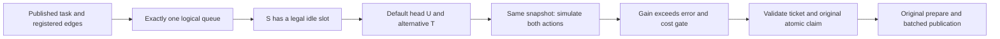

# Streaming TMR: slot-triggered action scheduling plan

**Status: proposal, 2026-11-27. Not implemented or measured.**

[中文](../../../zh/experiments/tmr-cluster/streaming-action-plan.md) · [Completed round-two results](qkv-round2.md)

This plan supersedes the next-round experiment design, not the historical results.
Source reference: runtime `8ebbff77377175bbbdc8d8f7252897f3eb73e6f8`; publication baseline `5cb3b7920f2a35d8d5846118f6939d12eb232c92`.
The first deliverable is A–D plus the two submission timings of the diamond experiment. Training follows only if the analytical policy has a credible benefit that covers its cost.

## 1. Motivation and changed decision point

Round two measured Shared / original / improved / learned medians of **36.831 / 40.005 / 37.668 / 37.616 ms**. Central pending/S0 waiting was the leading observed original cost. Improved and learned still regressed against Shared; learned did not establish stable net benefit. Ordinary MIX coverage in a separate test does not imply coverage of Qwen's synchronous attention.

The next experiment replaces centralized assignment with **a bounded comparison at an S that can actually dispatch**. It initially handles only ordinary AIC/AIV tasks with one block and no previous block claim. Multiblock, MIX, sync-start, strict binding, predicate special paths, DUMMY and staged tasks retain their protocols; their real resource occupancy still enters the calendar. No online training or whole-graph scanning is introduced.

An AICPU side is a scheduling domain, not a proven compute-cache locality domain. Same-side preference requires paired calibration of actual producer/consumer physical groups and input reuse. Unknown placement, unknown regions or an unstable effect produces a neutral hint.

## 2. Online information contract

At decision time, read only atomically published metadata and registered dependencies visible through the observed version. A final graph filtered merely by submission timestamps is insufficient evidence of visibility.

| Input | Required visibility | Use |
|---|---|---|
| Task resource, kernel, launch shape, ready age | Task published | Span and age |
| Producer placement and tensor region | Recorded dependency and actual location | Calibrated locality |
| Local idle slot, peer summary, running/pending/committed work | Readable snapshot with timestamp and version | Earliest feasible execution |
| Three queue heads | Published, generation-checked head metadata | Default and alternative |
| Successor and all relevant incoming dependencies | Submission and dependency registration complete | Visible join estimate |

Each successor has `UNSEEN`, `REGISTERING` or `USABLE` visibility. `USABLE` means metadata complete, not execution-ready. An empty successor index means unknown future fanout until an explicit submission-scope/fanout seal exists. Seeing one complete successor does not seal all future successors. Unknown execution location yields neutral locality.

No feature may encode final fanout, future graph variant or a future successor. Store observed publication/registration epochs in each decision record. The full graph is for retrospective explanation and separately labelled information-reference experiments only. A heuristic with the full graph is not a proven performance upper bound; exact small-graph search provides only a bound under its stated time model.

## 3. Queues, default action and ownership

For each pure resource class, expose three logical queues: neutral, prefer 0, prefer 1. Preference is soft and never grants exclusive ownership. A task is published exactly once into one queue. Neutral can retain the existing Shared queue and its ineligible ordinary work; preference queues contain eligible tasks only. If the default head is ineligible, use its original dispatch path rather than scanning past it to manufacture a comparison.

Define the B–F default as the oldest ready **legal head across all three queues**, breaking ties by queue number then task generation/ID. It is not assumed to match the order of unchanged Shared A. B–F share classification, hints, queue structure, probing and claiming. B ignores the hint when selecting. Thus B–A measures the entire structural path, including metadata/classification, not pure queue instructions alone.

A full preference queue falls back to neutral before publication ownership transfers. Neutral-full handling must preserve the original bounded-capacity/backpressure and progress protocol. Prove this at Gate 0; never silently drop, spin indefinitely or publish twice. Zero-fanin and already-completed-fanin O fast paths must participate in the same publication certificate as S-ready paths without applying the lifecycle CAS twice.

### Safe observation is a prerequisite

The current Vyukov queue reads its non-atomic task payload only **after** acquiring the dequeue ticket. Reading that payload before ownership and checking the sequence twice is still a C++ data race during recycle. Pop-and-repush is also not a safe peek.

The implementation must first provide immutable, atomically published head metadata, a proven read lifetime, generation checks and exact-ticket consumption. Queue-position ownership and original task/block ownership remain separate. Do not dereference reclaimable task payloads during speculative scoring.

Proposed interfaces, not existing APIs:

```cpp
struct HeadToken {
  uint64_t queue_ticket, task_generation, metadata_epoch;
  TaskId task_id;
};
struct VisibleHead { HeadToken token; ImmutableTaskFeatures features; };
// ReadGuard pins metadata lifetime; validate head and task generation on commit.
std::optional<VisibleHead> observe_head(ReadGuard&);
OwnedQueueItem consume_exact(const HeadToken&);  // may fail without consuming
// Then use the existing task/block claim protocol before prepare/publish.
```

A changed ticket invalidates the estimate. Use a bounded fresh default attempt or retry next scheduler pass, without spinning. If drain, sync or slot ownership changes after dequeue, use a proven owned-task continuation/requeue path with exactly one owner. Queue storage, read guards and task reuse must be validated together before enabling policy C.

## 4. Slot-triggered flow

The policy returns only the chosen task, predicted net gain and reason; trace records retain the comparison details.

A usable slot means the original normal `DispatchPhase::IDLE` path permits immediate dispatch, after sync, drain, staging and prepared/pending precedence. An empty pending mailbox alone is insufficient. Both actions target the **same physical slot**; no simultaneous core-placement optimization is added.

Initial bound: at most one comparison per original normal-IDLE pass; fill remaining slots with B. Preserve existing cross-task prepare and batched register publication/barriers. Report throttled opportunities and freeze this bound after pilot. No new S0 allocation queue is used.

```text
on_original_normal_idle_pass(side, physical_slot):
    heads = observe_three_legal_heads_with_lifetime_guards()
    U = oldest_legal_head(heads)                    # B default
    if U absent: return_to_original_loop()
    T = oldest_other_eligible_head(heads, U)       # fixed bounded rule
    if U ineligible or T absent or U/T preference_age_expired:
        try_original_claim_and_dispatch(U); return
    snapshot = capture_visible_versioned_state()
    if snapshot unreliable or budget exceeded:
        try_original_claim_and_dispatch(U); return
    a0 = simulate(U_now, T_later, default_B_continuation, snapshot)
    a1 = simulate(T_now, U_later, default_B_continuation, snapshot)
    chosen = T if gain(a0,a1) > optimism_bound + extra_cost + delta else U
    consume_exact_then_original_claim(chosen)     # no slot/head reservation by peek
    prepare_with_original_protocol_or_retry_next_pass()
```

When only one legal head exists, dispatch it regardless of peer-summary age or preference. The initial `10 µs` preference expiry is a ready-age veto on further model overrides, not a promise that ready-to-start latency is bounded by 10 µs. Never leave a usable slot idle to wait for the preferred side. Record no-alternative, expiry, stale/missing state, race and budget fallbacks separately. Sample observation/pop, snapshot/calendar, scoring, commit/publication and S dispatch gaps separately; full-path totals must include unsuccessful comparisons.



## 5. Bounded resource calendar and objective

Maintain incremental calendars from running, pending, prepared and early-dispatch commitments, rather than scanning queues. Track work by `(task generation, block)` so Shared work is inserted once, not once per side. Respect actual compatible groups, including mixed occupancy and sync cohorts. Slot observations are predictions, never reservations.

At most three heads, one alternative and one visible join are considered per comparison. Proposed pilot limits are two indexed successors and join fanin at most four. Overflow or incomplete registration disables join lookahead for that comparison; never truncate predecessors and treat the omitted ones as completed. Calendar size is hardware-bounded; model input is at most eight events.

For running elapsed time `e`, use conditional remaining duration:

\[
\hat r(e)=Q_{50}\{d_i-e\mid d_i>e\}.
\]

For spans `6,8,10,15,17 µs` and elapsed `11 µs`, the estimate is `5 µs`. With no surviving historical samples, use a separately calibrated coarse/tail fallback or decline the comparison. Never infer zero from `median(d)-e`. Observed FIN overrides prediction.

\[
\hat F_v(a)=\max(t,\hat H_v(a),\hat R_v(a),\hat D_v(a))+\hat P_v(a).
\]

`H` is compatible-slot availability; ready tasks use actual ready time in `R`. If `D` is separate, it is earliest **dispatch completion/publication**, including service duration. If service is already inside the span/calendar proxy, omit separate `D` to avoid double counting. `P` includes calibrated placement and concurrency effects under the declared start-proxy definition.

For a completely visible completion-gated join:

\[
\hat R_J(a)=\max_{p\in pred(J)}[\hat F_p(a)+\hat E^{remaining}_{p,J}(a)].
\]

Completed dependencies use observed release events. Count only future, unperformed edge work. RETAIN and WAIT semantics differ: use the actual release gate; unsupported gates disable lookahead. Kernel-time locality belongs in `P`, not again in edge cost.

Freeze one endpoint set for both actions. Without a usable join, include T, U and visible affected competitors. A join-ready endpoint may replace a predecessor endpoint only when dependency semantics prove domination; retain other competitors. Take the maximum endpoint time as `M(a)`, not a sum. Simulate both tasks and the bounded visible competitors under the same default continuation.

| Visible prefix | Default endpoint | Alternative endpoint | Predicted gain |
|---|---:|---:|---:|
| T:18→14, U:10→16 µs; no usable J | 18 | 16 | 2 µs |
| J visible; other predecessor arrives at 20 µs | 20 | 20 | 0 µs |
| J visible; other predecessor arrives at 12 µs | 18 | 16 | 2 µs |

In the last row J advances by 4 µs but U limits net local benefit to 2 µs. A successor submitted later cannot retroactively change the decision's endpoint definition or training label.

## 6. Error gate and independent paired calibration

\[
\hat G=\hat M(a_0)-\hat M(a_1),\qquad
\text{override iff }\hat G>Q_{90}[(\hat G-G_{obs})_+\mid b]+C_{extra}+\delta.
\]

Initial pilot `delta=0.5 µs`; freeze it, expiry, summary-age bounds and all parameters before formal timing. `C_extra` counts only action-specific unmodelled costs. Common inference cost is assessed by whole-run timing, not subtracted twice. The empirical optimism quantile is not a guarantee of 90% realized benefit.

Bins use summary age, concurrency and join visibility. Calibrate on paired blocks independent of model fitting and tuning. Require at least 30 independent paired blocks per retained bin, otherwise back off hierarchically; without adequate coarse data, default. Correlated repetitions within a block do not become independent samples; use a conservative block statistic such as maximum optimism. Six initial periods alone cannot support fine-bin tail calibration.

| Calibration | Matched contrast | Required output |
|---|---|---|
| Control handoff | Light chain, same/cross side; consumer slot reserved in both benchmark arms | FIN observation→edge release, ready publication→claim, claim→dispatch paired differences |
| Data locality | Same consumer kernel; 4 KiB, 64 KiB, 1 MiB reuse plus low-reuse control | Physical-group span difference and confidence; unstable effect becomes neutral |
| Span and remaining time | Kernel, shape, resource mask and concurrency | p50/p90 spans, conditional remaining table, counts and fallback levels |
| Action benefit | Matched preparatory state, force a0 or a1 once, then identical B continuation | T/U completion, visible J ready, graph end and paired local gain |

Start each microbenchmark with six paired periods, one warm-up and twenty repetitions per condition per period. Exchange order and direction while fixing kernels, inputs and physical mappings. Pre-register observable prestate matching/rejection rules before inspecting outcomes. A matched prestate is not a claim of identical cache state. Benchmark slot reservation is a fixture, not an online peek reservation.

If CPU side and physical group cannot be varied independently, report a combined placement effect rather than attributing it to hardware transfer. Resource waiting must not serve as a control-handoff label. Nonrepeatable Qwen states produce factual timelines, not fabricated paired causal labels; replay labels remain separate.

## 7. Trace, clocks and streaming replay

Required diagnostic schema (proposed):

```text
run_id, task_id, task_generation, pred_id, edge_kind, tensor_region
submit_ts, edge_registered_ts, edge_released_ts, ready_ts, publish_ts
claim_ts, dispatch_ts, start_proxy_ts, start_proxy_kind, fin_seen_ts
publisher_s, claimer_s, producer_side, execution_side, physical_group
resource_shape, slot_state, summary_ts, summary_version
decision_ts, observed_submit_epoch, observed_registration_epoch
visible_successor_state, head_tokens, endpoint_ids, a0, a1
predicted_gain, optimism_bin, decision_reason, decision_cost
```

Validate cross-thread clock offset/drift and units before comparing timestamps. Preserve proxy families: idle publication, observed pending promotion, doorbell and FIN-only censoring are not automatically equivalent actual starts. A FIN-only sample cannot supervise a runtime span. Record sampling probability and missingness; include O fast paths and task lifecycle reuse.

Replay exposes only events already visible in each prefix and registration epoch. After an action change, recompute modeled resource release and successor ready; do not replay recorded future ready timestamps as fixed truth. Fixed O submission trajectories estimate only that trajectory if submission depends on execution progress. Validate adaptive-policy rollout separately from one-action counterfactuals.

Round-two traces/replay are useful historical diagnostics, but do not prove this new visibility contract or microsecond action-gain accuracy. Old full graphs and old residual weights are not new paired labels. A small makespan replay error can coexist with large per-task timing error.

## 8. Execution gates and experiment matrix

### Gate 0 — protocol and observability

Implement clocks, publication/registration visibility, safe queue metadata/claim, bounded capacity and drain liveness before model work. Tests must cover queue wrap/recycle, two S racing for one head, lost slot, duplicate ready notification, queue-full fallback, single candidate, ineligible head, shutdown and sync/drain coexistence. Assert one publication owner, one block claim, one dispatch and empty queues at exit. Preserve TaskPayload ABI/tensor offset and existing barrier protocol.

### Gate 1 — what can streaming TMR see?

Run unchanged Shared diagnostics. A prefix-only shadow view may estimate three-queue opportunities without changing Shared claims; label these as shadow opportunities and remeasure actual rates in B. Report denominators for successor submitted, fully registered, usable join, changed action ranking, missing/stale state and one-candidate cases.

Mandatory tests:

1. Same visible prefix, different future graph: decision, features and reason identical before future submission.
2. Same diamond, J submitted before versus after T claim, with fast/slow sibling: only the early, fully registered J may affect lookahead.
3. J partially registered or successor index empty/unsealed: distinguish incomplete/unknown from proven absence.

Do not run a clairvoyant policy as if it were online. A retrospective graph-information reference uses the same time model; a reference also given true future durations must be separately labelled.

### Gate 2 — analytical A–D first

| Group | Behavior | Interpretation |
|---|---|---|
| A Shared | Original public claiming | Practical baseline |
| B Structure | Three queues, common hints/probes/claim; oldest legal head | Structural overhead |
| C Two-action | B plus calendar, predecessor locality, displaced work and gain gate | Streaming local information value |
| D Visible join | C plus fully visible bounded join | Incremental graph information value |

Run equal-block heterogeneous spans, both diamond submission timings and fanout→join before decode. Include short chain, ordinary MIX interference and synchronous attention coexistence while MIX itself stays outside the new selection policy. Check dependency legality, exactly-once dispatch, compatible group matching, empty exit queues and output correctness.

Target decode: existing Qwen3-14B batch 16, forty layers, sequence length 3500. Proposed held-out lengths: 2250 and 5000, subject to initial memory/input/golden feasibility checks, then frozen before tuning. Hold out an entire graph family or scale as well. Retain all forty-layer KV goldens for every dispatched policy. Do not reuse held-out results for later architecture/threshold tuning.

If visible joins are rare, freeze a C-local branch based on development pilot; keep D as a separate graph ablation. If neither C nor D shows credible value after cost, deliver the negative A–D result and stop model escalation.

### Gate 3 — residual learning, then actual deployment

Learn the **two-action gain residual**, `G_observed - G_analytical`, with E linear and F single-head QKV, dimension 8 and at most eight events. Q encodes action, target side, earliest-start difference and displaced head. K/V encode actual producers, visible sibling predecessors, compatible slot releases and competitors. Unknown successors have masks/missing flags. Dependency max, compatibility and claiming remain explicit.

Use the same inputs and dispatch path for D/C-local, E and F. Keep board-paired data and calibrated replay counterfactuals in separate datasets and report both. Supervise factual action times only for executed actions; a counterfactual action difference requires paired or explicitly simulated labels. Split by whole run and graph family/scale, keep pair arms together, fit normalization on training only, and reserve independent calibration blocks plus sealed test data.

Report held-out mean/p95 **actual time lost by choosing the wrong action**, choice rate, calibration and failure cases, not merely residual MAE. Freeze endpoint definitions at decision time. Replay must recompute downstream events, and its error at the action-gain scale must be validated before using its rankings.

Deployment requires F to improve held-out decision loss over E and the analytical baseline without an unacceptable tail regression. On AICPU, measure diverse real snapshots and cold/missing-mask cases. Initial budget: added p95 **whole triggered comparison path ≤1 µs**, with inference and probe/validation breakouts. Do not divide the old 16-score batch p95 by sixteen: it is not a single-trigger measurement. Freeze acceptance thresholds in the pilot; failure leaves F in shadow mode.

If gates pass, actually dispatch **both E and F** alongside same-round A and the selected analytical baseline. Round two did not formally dispatch the linear model, so it cannot establish F's net advantage over E. If joins are rare, the predecessor/resource-only model is primary; adding join entries remains a separate ablation.

## 9. Formal timing and reporting

Begin with twelve interleaved periods, each policy/workload having one retained warm-up and five formal samples per period: **60 formal + 12 warm-ups**. Use an independent pilot to freeze sample count before formal runs; no optional stopping or weight/threshold changes. A–D and later A/analytical/E/F each have four policies: use four cyclic position rotations, forward/reverse/forward across twelve periods. If all six groups are retained, use six forward and six reverse rotations; this balances positions without claiming complete carryover balance.

Fix card, CPU mapping, physical group mapping, kernel fingerprints, input, build flags, metadata mode, calibration and model hashes. Prefer the same binary with quiescent/reset policy switching. Preserve the same process/input/cache reset and warm-up conditions; otherwise record the fixed process design. Freeze scheduling metadata/reset semantics so no state leaks across policies. Separate detailed diagnostics from formal timing.

Report paired period effects and block-resampled intervals, preserving all raw samples and warm-ups:

- Device-wall median and p95, relative Shared difference and uncertainty; include p95 uncertainty and failures.
- Pending/ready-to-claim and claim-to-dispatch distributions by clock/proxy family; S dispatch gaps.
- Join opportunities, D versus C join advances, compatible-slot idle time and affected cross-side tasks.
- Comparisons, overrides, default/fallback reasons, coverage by type, per-trigger and cumulative cost; also O metadata overhead.
- Held-out decision loss, actual E versus F device-wall net gain and disagreement cases.

A locally better predicted endpoint does not establish whole-run benefit. Report regressions, model rejection and no-benefit outcomes unchanged.

## 10. Concrete implementation map and acceptance artifacts

Paths below refer to runtime source `8ebbff773`; line anchors are approximate at that revision. All new names/interfaces are proposals, not runnable commands or completed features.

| Existing location | Planned change |
|---|---|
| `runtime/scheduler/scheduler.h` (~74–302, ~786, ~1349) | Prove safe head observation/exact consume; three queues; unify publication ownership across route variants |
| `runtime/orchestrator.cpp` (~1318–1360 and `wire_fanin_task`) | Publish submission/edge-registration epochs and completion of successor metadata, including direct-ready fast paths |
| `runtime/scheduler/scheduler_dispatch.cpp` (~468–611, ~1326) | New policy branch at normal IDLE; keep original claim and batched publish; bypass S0 batch allocator for new policies |
| `runtime/scheduler/scheduler_completion.cpp`, `scheduler_context.h` | Incremental placement/calendar events, proxy families, actual release semantics |
| `runtime/shared/runtime_init.cpp`, `runtime/qkv_trace.h` | Queue capacity, arena/lifetime/reset, versioned summaries and trace schema |
| `tests/ut/cpp/a2a3/runtime/tensormap_and_ringbuffer/test_scheduler_state.cpp`, `test_wiring.cpp` | Lifecycle races, prefix visibility and clock/calendar deterministic cases |
| `tests/st/a2a3/tensormap_and_ringbuffer/` | Diamond timing, chains, fanout/join, mixed interference, golden and drain cases |

Runtime paths are under `src/a2a3/runtime/tensormap_and_ringbuffer/`; `scheduler_context.h` is under its `runtime/scheduler/` directory. Proposed new runtime modules: `runtime/streaming_metadata.h` and `runtime/streaming_action.h`. Keep metadata outside TaskPayload to preserve the existing tensor ABI.

Before (conceptual existing path):

```cpp
// Eligible ready work can enter the centralized QKV allocation path.
// Normal dispatch takes a ready batch, claims block ranges, prepares, then publishes.
```

After (proposed control boundary):

```cpp
if (policy == Shared) return original_shared_dispatch();
// B-F share the same queues, hints and normal-IDLE ownership protocol.
if (!normal_idle_slot || sync_or_drain_precedes) return original_protocol();
auto heads = observe_heads_with_read_guard();
auto choice = policy == Structure ? default_head(heads)
                                  : bounded_two_action_choice(heads, snapshot);
// Conditional consume and original unique block claim; preserve batched barriers.
return prepare_claimed_choice_in_original_batch(choice);
```

The pseudocode does not authorize bypassing real sync/drain checks or invent a safe peek for the current queue. First implement and test that prerequisite, then clock/visibility diagnostics, calendars/calibration, B/C/D, and only then E/F.

Proposed artifact directory: `official-results/streaming-action-<collection-date>/`, created only when new data exist. Proposed benchmark tooling under `examples/a2a3/tensormap_and_ringbuffer/benchmark_streaming_action/`: event schema/validator, paired calibrator, prefix replay, split manifest, linear/QKV trainer, AICPU shadow harness, frozen policy manifest and interleaved runner. Publish executable CLI examples only after those tools exist and are tested.

Acceptance package must contain source diff and exact build/test commands; card/topology/kernel fingerprints; event schema and clock validation; protocol tests and both diamond timings; microbenchmark raw pairs and calibration tables; prefix replay tests and limitations; grouped split manifests, weights and normalization if training proceeds; all formal samples/warm-ups and paired statistics; one-page A–D conclusion and, if admitted, measured E/F net benefit. With no board access, deliver CPU/protocol/replay evidence separately and mark board calibration, golden, shadow budget and device-wall comparisons as unfulfilled.
