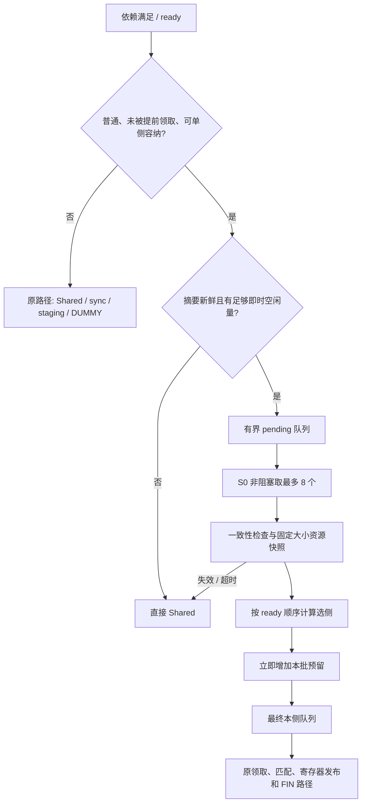

# QKV 第二轮机制与实验流程

可以把两个 AICPU cluster 理解为两个调度站，S0 是第一版额外增加的分流员。
Shared 中任务 ready 后直接进入公共候车区，由原来的 S 领取。初版 QKV 在公共候车区
前增加一个最多容纳 64 个任务的待分配区，只有 S0 负责取出任务并决定去哪个站。
每次最多取当前已有的 8 个；只有一个也立即处理。



第二轮首先测量多出来的“候车区”是否值得。ready→pending 出队表示等分流员；
出队→最终发布表示一次分流服务；最终发布→首次寄存器派发表示选站后等待。
S0 的服务再拆成 pop、快照、评分和发布，并记录它自己的相邻派发间隔。
采样不等待凑批，详细记录在工作结束后输出。完整 DAG 日志本身可能增加数百毫秒，
因此这些运行只作诊断，正式计时关闭逐任务记录。

## 评分为什么确实是 QKV

每个候选侧有三个永久条目：排队、running/pending 占用、空闲不足。
它们属于同一侧、同一资源类别，其余条目被 mask 排除。令
`u=blocks/capacity`、`q=queued/capacity`、`o=occupied_ratio`、
`h=1-idle/capacity`、`a=min(wait_ms,1)`。
旧公式的三个 logit 都有相同的 `3/sqrt(6)`，softmax 会把它抵消，故可以精确化简为：

```text
Lqueue = u*q/sqrt(6)
Lrun   = u*o/sqrt(6) + a/(2*sqrt(6)) + 1/4
Lidle  = u*h/sqrt(6) + a/sqrt(6) - 1/sqrt(6)
pressure = softmax(L) · [q/2, o, h/2]
score = (queued + batch_reserved + blocks)/capacity + pressure
```

同批相同 blocks 的候选可缓存与年龄无关的部分；年龄只需一个指数因子及其平方。
这是旧公式的代数化简，不是拟合替代。单测分别比较压力数值和连续 8 个任务的选择，
覆盖 2,000 个确定性生成的状态。若两侧基础负载接近而一侧在途占用很高，注意力项
可以把任务分到另一侧；如果两侧完全相同，首任务选编号小的一侧，预留增加后次任务选另一侧。

## 为什么减少进入 pending 的任务

短消融保持同一 pending、S0 和批内预留，只关闭注意力项。另一个诊断对照保留集中
服务和基础选侧计算，但最终发布到 Shared。这两项用于区分集中排队、计算与绑侧等待。
第二轮的改进只让资源摘要新鲜且存在足够即时空闲量的任务进入 pending；其余直接
Shared。必须同时报告覆盖率下降、回退原因和计时变化，不能把回退误写成原型完成分配。

摘要由各 S 更新本地 resource word、时间戳和版本，S0 作轻量读取。
版本奇数或前后变化、未初始化、超过 200 µs，分别作为不同原因回退。
原执行路径仍按实时资源检查，摘要没有派发硬件的权限。S0 在 drain 的 continue 之前
服务 pending，确保同步任务共存时仍可推进。最终队列发布只有一个拥有者，没有任务迁移。

## 普通 MIX、DUMMY 与提前派发

纯 AIC/AIV 分别使用自己的 block 账本。普通 MIX 按 active_mask 分账：3、5、6、7。
每个计算组由 AIC、AIV0、AIV1 组成。只有同一组内所需的全部槽位满足条件，才计入
可立即派发或可接受 pending 的组数。直接复用 CoreTracker 的分类与匹配函数，
不能把两边聚合 AIC/AIV 空闲量取最小值来冒充兼容组数。

单侧放不下的大任务继续 Shared。同步任务、严格绑侧、谓词特殊路径、DUMMY 和
已被 stager 领取的任务保持原协议。DUMMY 内联处理，采样 ready 等待、处理时间、
释放后继数和执行 S；用于解释 S 压力及回放中的 CPU 服务时间。提前派发记录候选、
成功 enqueue、queue-full 回退、doorbell 放行和采样槽位占用。候选减命中并不都代表
队列满，报告将这些口径分开。Qwen 的同步 fused attention 不经过普通 MIX 分流。

## 反馈校准、训练与回放

时间线分开记录派发、启动代理、首次 FIN、最终 FIN、完成处理和后继 ready。
当前没有 AICore 实际开始时间；代理分别标注首次寄存器发布、pending 提升或 doorbell
放行。仅在 FIN 处补记的启动属于删失观测，不作为运行时间监督。

校准表按 kernel 组合、block 数、active_mask 和同步规格分组，仅用训练运行拟合
运行跨度与序列长度的关系。启动等待基础估计使用排队、批内预留和在途占用。
这些是代理口径的估计，不能解释为精确的单 block 内核执行时长。

同一份真实动作数据训练岭回归残差模型和学习 Q/K/V 投影的单头模型；两者均预测
相对于基础时间模型的等待与运行时间残差。512/1750 长度的完整运行用于训练，2625
用于验证与早停，3500 用作留出集；不按重复层随机拆行。归一化也只在训练集拟合。
真实数据只监督实际执行的一侧。另一侧标签由资源日历回放独立生成，重新计算资源
释放和后继 ready，不混入真实监督。回放误差与反事实标签的近似性质单独报告。

预先固定的质量门槛是：单头注意力留出集综合 MAE 至少比线性低 2%，两个目标均
不变差；8 任务、16 候选的 CPU 影子推理 p95 不超过 50 µs。主机原生推理还与
PyTorch 权重逐项核对。模型通过门槛后仍需板上 AICPU 影子预算验证，才能接入派发。
不通过就保留训练结果，正式对照只包含 Shared、原 QKV 和改进 QKV。

## 训练版实际怎样选侧

模式 4 沿用模式 3 的准入、摘要、回退和批内预留，用冻结时间模型替代固定公式的最终评分。
12 维显式特征生成 4 维 Q；三个 5 维资源条目投影为 4 维 K/V，单头结果与线性跳接共同
输出等待、运行跨度的两个残差，共 136 个参数。评分是
`max(0, base_wait + residual_wait) + max(0, base_runtime + residual_runtime)`，单位 µs。
每次选侧后更新预留，再计算下一任务。找不到 kernel/launch/mask 校准项时回到固定公式，
并单独计数。当前导出表只适用于 Qwen seq_len=3500，不在运行时更新权重或校准参数。

本轮实际通过留出质量和 AICPU 影子预算门槛后才启用模式 4。完整回放另采六次运行，每次
11,166 任务、23,605 边，核对提交数、追踪数与全部端点；同一同步批必须占用不同物理组。
旧追踪漏掉的快速路径没有被补造成训练标签。原 QKV 的第二轮计时表示统一二进制中的
原公式/路由模式，并非旧版本二进制逐位复跑。原始快速直接发布路径仍沿用 Shared 协议。

## 正式实验顺序

先完成输出及全部 40 层 K/V cache golden、短链和 MIX/sync 回归，再冻结参数、
校准表、权重、源码和二进制指纹。六个时段轮换并反转策略执行顺序；每个进程六轮，
第一轮作为 warm-up 保留，后五轮计入正式样本，每策略共 30 个。所有实际加载的
37 个计算 kernel 指纹必须相同。报告中位数、p95、覆盖率、批次分布、回退原因、
决策耗时与诊断等待，性能退步同样保留。

复现命令和原始结果见 `results/qkv-round2-20261125/REPRODUCE.md`；
本轮结论以该目录的最终报告为准。
